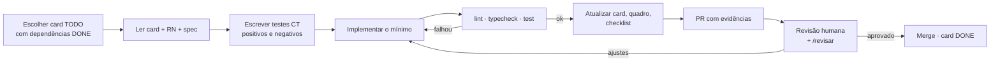

# Desenvolvimento assistido por IA

Esta pasta transforma os documentos de produto (`docs/`) em **unidades de trabalho que um agente
consegue executar com segurança**: contratos precisos (specs) e tarefas pequenas e verificáveis
(cards).

## Organização e por quê

```
AGENTS.md                  ← carregado automaticamente por Codex, Cursor, Copilot, Gemini…
CLAUDE.md                  ← carregado pelo Claude Code; importa o AGENTS.md (@AGENTS.md)
apps/api/AGENTS.md         ← regras locais, carregadas ao trabalhar dentro da pasta
apps/web/AGENTS.md
.claude/commands/          ← atalhos /card e /revisar no Claude Code
.github/pull_request_template.md
docs/                      ← produto: plano, requisitos, regras, arquitetura, dados (humanos + IA)
ai/
  specs/                   ← contrato por módulo: API, erros, eventos, casos de teste (CT)
  cards/                   ← tarefas executáveis (LC-xxx) + quadro de status
  templates/               ← modelos de spec e card
  prompts/                 ← prompts prontos para qualquer ferramenta
```

| Escolha | Motivo |
|---|---|
| **`AGENTS.md` na raiz, curto** | Padrão aberto lido por quase todas as ferramentas; fica sempre no contexto, então guarda só o protocolo, os invariantes e os ponteiros, sem copiar os documentos. |
| **`CLAUDE.md` = `@AGENTS.md`** | Uma fonte só de instruções; o Claude Code lê `CLAUDE.md` e importa o resto. |
| **`AGENTS.md` por app** | Convenções de back e de front só entram no contexto quando o agente trabalha naquela pasta. |
| **Specs separadas dos docs de produto** | `docs/` diz *o quê e por quê*; a spec diz *exatamente como o módulo responde* (rotas, payloads, códigos de erro, eventos, casos de teste). É o que o agente precisa para não inventar contrato. |
| **Cards pequenos (½ dia no máximo)** | Cabem numa sessão de agente e num PR revisável; têm critérios de aceite e testes obrigatórios, o que torna o "pronto" verificável. |
| **IDs rastreáveis** (`RF`, `RNF`, `RN`, `SP`, `CT`, `LC`) | O agente cita a regra que está cumprindo; o revisor confere teste ↔ regra; a matriz em `docs/01-requisitos.md` mostra cobertura. |
| **Prompts versionados** | O mesmo fluxo funciona em qualquer ferramenta e fica registrado para o relato de uso de IA. |

## Fluxo de um card



- **Humano decide, IA executa:** escolha de card, revisão do PR e merge são meus. A IA não
  marca card como `DONE` sem a saída dos testes no PR.
- **Uma sessão de agente por card.** Contexto limpo reduz alucinação e mistura de escopo.
- **Testes primeiro.** Os casos `CT` da spec viram testes antes do código.
- **Tudo que a IA fez e o que eu revisei** é revisado por mim antes do merge; o resumo vai no formulário de entrega.

## Como usar

| Ferramenta | Executar card | Revisar card |
|---|---|---|
| Claude Code | `/card LC-011` | `/revisar LC-011` |
| Outras | colar `ai/prompts/implementar-card.md` trocando `{{CARD}}` | `ai/prompts/revisar-card.md` |

## Índices

- Specs: [`specs/`](specs/) — SP-01 a SP-10
- Cards e quadro: [`cards/README.md`](cards/README.md)
