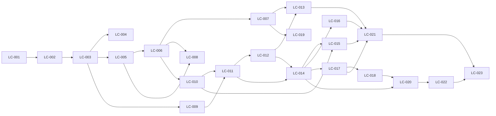

# Quadro de cards

Status: `TODO` → `DOING` → `REVIEW` → `DONE`. Só um card `DOING` por vez por agente.
Atualize esta tabela junto com o status no arquivo do card.

| Card | Título | Dia | Depende de | Status |
|---|---|---|---|---|
| [LC-001](LC-001-monorepo.md) | Criar o monorepo TypeScript com lint, testes e pacote shared | 1 | — | REVIEW |
| [LC-002](LC-002-banco-e-docker-compose.md) | Configurar Postgres, Drizzle, migrations iniciais e Docker Compose | 1 | LC-001 | REVIEW |
| [LC-003](LC-003-autenticacao.md) | Implementar cadastro, login, logout e autorização por papel | 1 | LC-002 | REVIEW |
| [LC-004](LC-004-ci-docker-deploy.md) | Configurar CI, imagem Docker única e deploy do esqueleto | 1 | LC-003 | DOING |
| [LC-005](LC-005-catalogo-externo.md) | Implementar o catálogo da API Art Institute com cache e circuit breaker | 2 | LC-003 | TODO |
| [LC-006](LC-006-criar-lote.md) | Criar lote com snapshot do item, imagem e gênese da cadeia | 2 | LC-005 | TODO |
| [LC-007](LC-007-vitrine.md) | Construir a vitrine com abas ao vivo, agendados e encerrados | 2 | LC-006 | TODO |
| [LC-008](LC-008-painel-leiloeiro-criar.md) | Construir a busca no catálogo e o formulário de novo lote no painel | 2 | LC-005, LC-006 | TODO |
| [LC-009](LC-009-carteira.md) | Implementar carteira com depósito simulado e saldo comprometido | 3 | LC-003 | TODO |
| [LC-010](LC-010-cadeia-auditavel.md) | Implementar a cadeia de hashes assinada e o verificador compartilhado | 3 | LC-006 | TODO |
| [LC-011](LC-011-motor-de-lance.md) | Implementar o motor de lance transacional com anti-sniping | 3 | LC-009, LC-010 | TODO |
| [LC-012](LC-012-realtime.md) | Implementar o gateway Socket.IO com salas de lote e de usuário | 4 | LC-011 | TODO |
| [LC-013](LC-013-sala-ao-vivo.md) | Construir a sala do lote ao vivo com feedback de lance | 4 | LC-012, LC-007 | TODO |
| [LC-014](LC-014-liquidacao.md) | Implementar o worker de encerramento e liquidação com comprovante | 4 | LC-011, LC-012 | TODO |
| [LC-015](LC-015-auditoria.md) | Construir a auditoria pública com verificação no servidor e no navegador | 5 | LC-010, LC-014 | TODO |
| [LC-016](LC-016-comprovante-e-arremates.md) | Construir comprovante público e a tela Meus arremates | 5 | LC-014 | TODO |
| [LC-017](LC-017-painel-resultados.md) | Mostrar lotes, resultados e total recebido no painel do leiloeiro | 5 | LC-014 | TODO |
| [LC-018](LC-018-cancelamento.md) | Implementar cancelamento de lote com estorno automático | 5 | LC-017 | TODO |
| [LC-019](LC-019-busca-e-filtros.md) | Adicionar busca e filtros à vitrine | 5 | LC-007 | TODO |
| [LC-020](LC-020-seed.md) | Criar o seed de demonstração com cadeia válida | 6 | LC-014, LC-018 | TODO |
| [LC-021](LC-021-dark-mode-e-acessibilidade.md) | Adicionar dark mode e revisar acessibilidade e responsividade | 6 | LC-013, LC-015, LC-016, LC-017 | TODO |
| [LC-022](LC-022-e2e.md) | Automatizar o fluxo completo com Playwright no CI | 6 | LC-020 | TODO |
| [LC-023](LC-023-entrega.md) | Publicar o deploy final, escrever o README e enviar o teste | 7 | LC-021, LC-022 | TODO |

## Dependências

## Ordem de corte se o prazo apertar

Do primeiro a cair para o último: LC-019 (busca/filtros) → LC-021 (dark mode) → parte pós-liquidação do LC-018 → LC-022 (E2E).
Requisitos base e deploy nunca entram no corte.
