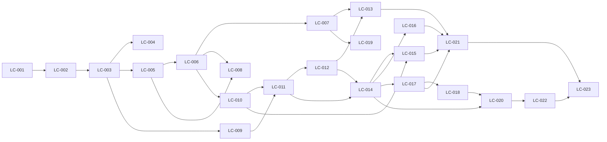

# Quadro de cards

Status: `TODO` → `DOING` → `REVIEW` → `DONE`. Só um card `DOING` por vez por agente.
Atualize esta tabela junto com o status no arquivo do card.

| Card | Título | Dia | Depende de | Status |
|---|---|---|---|---|
| [LC-001](LC-001-monorepo.md) | Criar o monorepo TypeScript com lint, testes e pacote shared | 1 | — | REVIEW |
| [LC-002](LC-002-banco-e-docker-compose.md) | Configurar Postgres, Drizzle, migrations iniciais e Docker Compose | 1 | LC-001 | REVIEW |
| [LC-003](LC-003-autenticacao.md) | Implementar cadastro, login, logout e autorização por papel | 1 | LC-002 | REVIEW |
| [LC-004](LC-004-ci-docker-deploy.md) | Configurar CI, imagem Docker única e deploy do esqueleto | 1 | LC-003 | DOING |
| [LC-005](LC-005-catalogo-externo.md) | Implementar o catálogo da API Art Institute com cache e circuit breaker | 2 | LC-003 | REVIEW |
| [LC-006](LC-006-criar-lote.md) | Criar lote com snapshot do item, imagem e gênese da cadeia | 2 | LC-005 | REVIEW |
| [LC-007](LC-007-vitrine.md) | Construir a vitrine com abas ao vivo, agendados e encerrados | 2 | LC-006 | REVIEW |
| [LC-008](LC-008-painel-leiloeiro-criar.md) | Construir a busca no catálogo e o formulário de novo lote no painel | 2 | LC-005, LC-006 | DONE |
| [LC-009](LC-009-carteira.md) | Implementar carteira com depósito simulado e saldo comprometido | 3 | LC-003 | DONE |
| [LC-010](LC-010-cadeia-auditavel.md) | Implementar a cadeia de hashes assinada e o verificador compartilhado | 3 | LC-006 | DONE |
| [LC-011](LC-011-motor-de-lance.md) | Implementar o motor de lance transacional com anti-sniping | 3 | LC-009, LC-010 | DONE |
| [LC-012](LC-012-realtime.md) | Implementar o gateway Socket.IO com salas de lote e de usuário | 4 | LC-011 | DONE |
| [LC-013](LC-013-sala-ao-vivo.md) | Construir a sala do lote ao vivo com feedback de lance | 4 | LC-012, LC-007 | DONE |
| [LC-014](LC-014-liquidacao.md) | Implementar o worker de encerramento e liquidação com comprovante | 4 | LC-011, LC-012 | DONE |
| [LC-015](LC-015-auditoria.md) | Construir a auditoria pública com verificação no servidor e no navegador | 5 | LC-010, LC-014 | DONE |
| [LC-016](LC-016-comprovante-e-arremates.md) | Construir comprovante público e a tela Meus arremates | 5 | LC-014 | DONE |
| [LC-017](LC-017-painel-resultados.md) | Mostrar lotes, resultados e total recebido no painel do leiloeiro | 5 | LC-014 | DONE |
| [LC-018](LC-018-cancelamento.md) | Implementar cancelamento de lote com estorno automático | 5 | LC-017 | DONE |
| [LC-019](LC-019-busca-e-filtros.md) | Adicionar busca e filtros à vitrine | 5 | LC-007 | DONE |
| [LC-020](LC-020-seed.md) | Criar o seed de demonstração com cadeia válida | 6 | LC-014, LC-018 | DONE |
| [LC-021](LC-021-dark-mode-e-acessibilidade.md) | Adicionar dark mode e revisar acessibilidade e responsividade | 6 | LC-013, LC-015, LC-016, LC-017 | DONE |
| [LC-022](LC-022-e2e.md) | Automatizar o fluxo completo com Playwright no CI | 6 | LC-020 | DONE |
| [LC-023](LC-023-entrega.md) | Publicar o deploy final, escrever o README e enviar o teste | 7 | LC-021, LC-022 | REVIEW |

## Dependências

## Ordem de corte se o prazo apertar

Do primeiro a cair para o último: LC-019 (busca/filtros) → LC-021 (dark mode) → parte pós-liquidação do LC-018 → LC-022 (E2E).
Requisitos base e deploy nunca entram no corte.

## Cards de profissionalização de portfólio

Plano de referência: [Plano de profissionalização (27/10/2026)](../../docs/plano-profissionalizacao-portfolio-2026-10-27.md).
Esta fila complementa os cards legados; não substitui suas dependências nem altera seus status.
Um card novo só pode iniciar quando todas as dependências indicadas estiverem DONE com evidência.
LC-024 audita e registra; não autoriza promover status herdado sem prova.

| Card | Título | Prioridade | Depende de | Esforço | Status |
|---|---|---:|---|---:|---|
| [LC-024](LC-024-reconciliar-evidencias-e-quadro-legado.md) | Reconciliar evidências e quadro legado | P0 | — | 2–3 h | DONE |
| [LC-025](LC-025-validar-demo-publicada-e-smoke-autenticado.md) | Validar demo publicada e smoke autenticado | P0 | LC-024 | 3–5 h | DONE |
| [LC-026](LC-026-diagnosticar-instabilidade-de-realtime-e-e2e.md) | Diagnosticar instabilidade de realtime e E2E | P0 | LC-024 | 3–6 h | DONE |
| [LC-027](LC-027-oferecer-acesso-contextual-a-demo-e-onboarding.md) | Oferecer acesso contextual à demo e onboarding | P1 | LC-024 | 4–6 h | DONE |
| [LC-028](LC-028-adicionar-favicon-e-metadados-sociais.md) | Adicionar favicon e metadados sociais | P0 | LC-024 | 1–2 h | DONE |
| [LC-029](LC-029-escrever-readme-de-portfolio.md) | Escrever README de portfólio | P0 | LC-025, LC-026, LC-028 | 3–5 h | DONE |
| [LC-030](LC-030-refinar-hierarquia-da-vitrine-e-sala.md) | Refinar hierarquia da vitrine e sala | P1 | LC-027 | 6–10 h | TODO |
| [LC-031](LC-031-distinguir-conexao-de-sincronizacao.md) | Distinguir conexão de sincronização | P1 | LC-026, LC-030 | 4–8 h | TODO |
| [LC-032](LC-032-explicar-auditoria-em-camadas.md) | Explicar auditoria em camadas | P1 | LC-024 | 4–7 h | TODO |
| [LC-033](LC-033-documentar-estudo-de-caso-de-engenharia.md) | Documentar estudo de caso de engenharia | P1 | LC-024, LC-026 | 3–5 h | DONE |
| [LC-034](LC-034-preparar-capturas-e-video-da-demonstracao.md) | Preparar capturas e vídeo da demonstração | P0 | LC-025, LC-028 | 3–5 h | DONE |
| [LC-035](LC-035-verificar-acessibilidade-manual-e-regressoes.md) | Verificar acessibilidade manual e regressões | P1 | LC-030, LC-031, LC-032 | 4–7 h | TODO |
| [LC-036](LC-036-montar-pacote-de-publicacao.md) | Montar pacote de publicação | P0 | LC-029, LC-034 | 2–3 h | DONE |
| [LC-037](LC-037-criar-laboratorio-local-com-fixture-de-auditoria.md) | Criar laboratório local com fixture de auditoria (opcional) | P2 | LC-032 | 4–8 h | TODO |
| [LC-038](LC-038-adicionar-favoritos-locais.md) | Adicionar favoritos locais (opcional) | P2 | LC-030 | 3–6 h | TODO |
| [LC-039](LC-039-definir-observabilidade-enxuta.md) | Definir observabilidade enxuta (opcional) | P2 | LC-026, LC-031 | 3–5 h | TODO |

### Ordem recomendada

1. LC-024 reconcilia evidências; depois LC-025, LC-026 e LC-028 podem avançar individualmente.
2. LC-029 depende da prova reunida por LC-025/026 e dos metadados LC-028; LC-034 prepara vídeo mínimo e imagens após LC-025/028.
3. LC-036 reúne pacote mínimo após LC-029/034. A meta de 29/10/2026 é uma meta, não garantia: as estimativas P0 somam aproximadamente 17–29 horas; se o tempo não comportar o escopo, reduzir explicitamente o pacote e manter alegações não comprovadas de fora.
4. LC-027, LC-030, LC-031, LC-032, LC-033 e LC-035 são trabalho posterior, conforme dependências. Melhorias materiais futuras devem atualizar seus cards responsáveis e a documentação, sem transformar LC-036 em gate artificial.
5. LC-037, LC-038 e LC-039 são opcionais: continuam TODO e só entram na fila após escolha explícita futura. Não representam bloqueio atual.

LC-025 e LC-026 coletam evidência operacional complementar que LC-023 exige; eles não dependem de LC-023 estar DONE, evitando ciclo. LC-025 não duplica o envio do formulário. O smoke manual autenticado com catálogo real permanece separado dos testes normais com FakeCatalog. Nenhum status antigo é promovido por estes cards.

### Mapa de fase para cards

| Fase do plano | Cards |
|---|---|
| Fase 0 — confiança e validação | LC-024, LC-025, LC-026 |
| Fase 1 — README | LC-029 |
| Fase 1A — Acabamento visual da primeira visita | LC-027, LC-030, LC-031 |
| Fase 1B — Auditoria legível por camadas | LC-032, LC-037 opcional |
| Fase 2 — Evidência visual e narrativa curta | LC-034, LC-036 |
| Fase 3 — Apresentação técnica verificável | LC-033 |
| Fase 4 — Documentação e acabamento de publicação | LC-028, LC-035 |
| Fase 5 — pacote de publicação | LC-036 |
| Extensões opcionais posteriores | LC-038, LC-039 |
