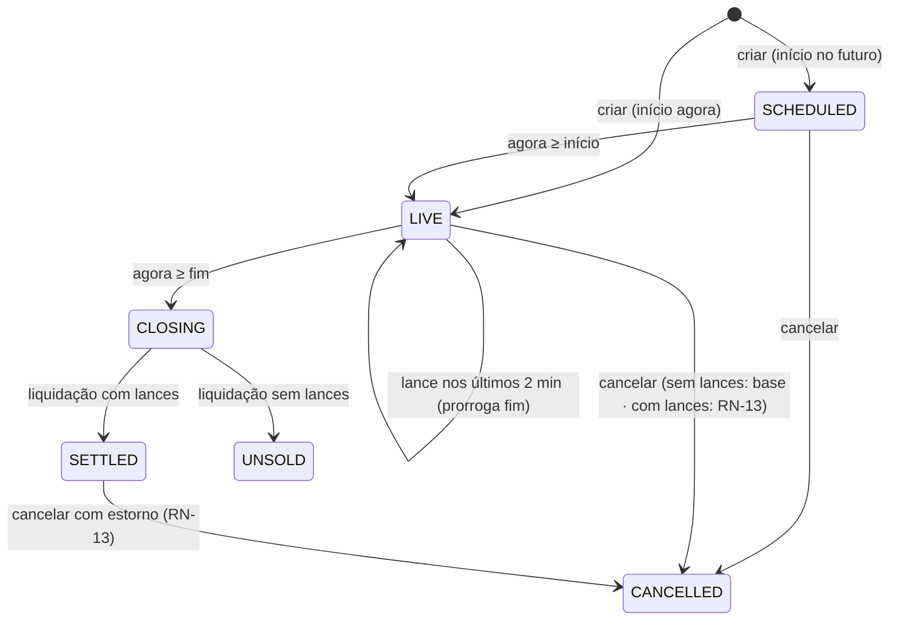

# 02 — Regras de negócio

Documento **normativo**: em conflito com plano ou specs, vale este. Toda regra tem ID estável
(`RN-xx`), é aplicada **no servidor** (a interface só antecipa) e tem ao menos um teste.

Convenções: dinheiro em **centavos inteiros** (BRL); "agora" é o relógio do **banco** (`now()`,
UTC); "lote" é a unidade leiloada.

---

## Usuários e papéis

**RN-01 — Papéis exclusivos.** Todo usuário tem exatamente um papel, escolhido no cadastro e
imutável: `AUCTIONEER` (leiloeiro) ou `BIDDER` (licitante).
- Só leiloeiro cria, cancela e vê resultados dos **próprios** lotes.
- Só licitante deposita e dá lance. Leiloeiro que tenta dar lance recebe `SELLER_CANNOT_BID`.
- Visitante (sem login) só lê: vitrine, sala (sem lance), auditoria, comprovante.

---

## Lotes

**RN-02 — Criação de lote.** Validações:
| Campo | Regra |
|---|---|
| `startingPriceCents` | inteiro ≥ 100 (R$ 1,00) e ≤ 1.000.000.000 (R$ 10 milhões) |
| `minIncrementCents` | inteiro ≥ 100 e ≤ `startingPriceCents` × 10 |
| `startsAt` | ≥ agora − 1 min (aceita "começar agora") |
| `endsAt` | ≥ `startsAt` + 5 min e ≤ `startsAt` + 30 dias |
| `title` | 3–140 caracteres (pré-preenchido pelo item, editável) |
| `description` | até 2.000 caracteres |
| `category` | uma de uma lista fixa (`Pintura`, `Escultura`, `Fotografia`, `Gravura`, `Desenho`, `Têxtil`, `Outros`) |
| item | precisa existir na API externa no momento da criação |

Depois de publicado, **o lote não é editável** (os termos fazem parte da gênese da cadeia —
RN-15). Para corrigir, cancela-se e cria-se outro.

**RN-03 — Fases do lote** (derivadas, nunca gravadas como texto):

| Fase | Condição |
|---|---|
| `SCHEDULED` (agendado) | `state = ACTIVE` e agora < `startsAt` |
| `LIVE` (ao vivo) | `state = ACTIVE` e `startsAt` ≤ agora < `endsAt` |
| `CLOSING` (aguardando liquidação) | `state = ACTIVE` e agora ≥ `endsAt` — dura no máximo alguns segundos; exibido como "encerrado" |
| `SETTLED` (arrematado) | `state = SETTLED` |
| `UNSOLD` (sem vencedor) | `state = CLOSED_NO_WINNER` |
| `CANCELLED` | `state = CANCELLED` |

**RN-14 — Vitrine.** Mostra `SCHEDULED`, `LIVE` e encerrados (`CLOSING`, `SETTLED`, `UNSOLD`).
**Nunca** mostra `CANCELLED`. Sala, auditoria e comprovante de lote cancelado continuam acessíveis
por link direto, com aviso "lote cancelado".

---

## Lances

Ordem de validação (a primeira que falhar define o erro):

| # | Regra | Erro |
|---|---|---|
| 1 | Usuário autenticado | `UNAUTHENTICATED` (401) |
| 2 | Usuário é licitante (RN-01) | `SELLER_CANNOT_BID` (403) |
| 3 | Lote existe | `LOT_NOT_FOUND` (404) |
| 4 | Lote não cancelado | `LOT_CANCELLED` (409) |
| 5 | Agora ≥ início (RN-04) | `LOT_NOT_STARTED` (409) |
| 6 | Agora < fim e não liquidado (RN-04) | `LOT_CLOSED` (409) |
| 7 | Usuário não é o líder (RN-06) | `ALREADY_WINNING` (409) |
| 8 | Valor ≥ mínimo (RN-05) | `BELOW_MINIMUM` (422, com `minimumCents`) |
| 9 | Valor ≤ disponível (RN-08) | `INSUFFICIENT_FUNDS` (422, com `availableCents`) |

**RN-04 — Janela.** Lance só é aceito com o lote ao vivo: `startsAt` ≤ agora < `endsAt`.

**RN-05 — Valor mínimo.**
- Primeiro lance: `valor ≥ startingPrice`.
- Seguintes: `valor ≥ currentPrice + minIncrement`.
- Exemplo: inicial R$ 1.000, incremento R$ 100. 1º lance válido ≥ R$ 1.000. Após lance de
  R$ 1.250, o próximo deve ser ≥ R$ 1.350.

**RN-06 — Sem auto-cobertura.** O licitante que lidera não pode dar novo lance no mesmo lote.

**RN-07 — Saldo.**
- `total` = soma de todos os lançamentos da carteira (depósitos, débitos, créditos, estornos).
- `comprometido` = soma de `currentPrice` dos lotes `ACTIVE` em que o usuário **lidera**.
- `disponível` = `total − comprometido`.
- Ao ser superado, o valor volta ao disponível **na mesma transação** do lance que o superou
  (o comprometido é derivado da liderança, não há "liberação" assíncrona).
- Exemplo: total R$ 10.000. Lidera lote A com R$ 3.000 → disponível R$ 7.000. Superado em A →
  disponível R$ 10.000 imediatamente.

**RN-08 — Lance cabe no disponível.** `valor ≤ disponível` no momento do lance. O lance é
avaliado contra o disponível **antes** dele (o usuário não lidera este lote, pela RN-06).
Dois lances simultâneos do mesmo usuário em lotes diferentes são serializados pela carteira:
nunca comprometem juntos mais do que o total.

**RN-09 — Anti-sniping.** Se o lance for aceito quando faltam **≤ 2 min** para o fim, o fim passa
a ser `momento do lance + 2 min` (nunca diminui). Pode acontecer repetidas vezes.
- Exemplo: fim 20:00:00. Lance às 19:58:30 → novo fim 20:00:30. Lance às 20:00:10 → 20:02:10.
- Lance às 19:57:59 (faltam 2:01) → fim não muda.
- Interpretação documentada: o PDF diz "estende o fim do lote para +2 minutos"; adotamos o
  *soft close* clássico (2 min a partir do lance), que garante a todos 2 minutos para reagir.

**RN-17 — Depósito.** Valor inteiro em centavos, `≥ 100` e `≤ 100.000.000` (R$ 1 milhão) por
operação. Requer `Idempotency-Key`; repetir a mesma chave não duplica o depósito. Não há saque.

**RN-18 — Idempotência de lance.** Lance aceita `Idempotency-Key`; repetir a mesma chave devolve a
mesma resposta, sem criar outro lance.

---

## Encerramento e liquidação

**RN-10 — Liquidação.** Quando agora ≥ `endsAt` e o lote tem lances, numa única transação:
1. débito de `currentPrice` na carteira do vencedor (`SETTLEMENT_DEBIT`);
2. crédito do mesmo valor ao leiloeiro (`SETTLEMENT_CREDIT`);
3. evento `CLOSED` encadeado e assinado (RN-15);
4. comprovante gerado (RN-19);
5. `state = SETTLED`.

Executa **exatamente uma vez** por lote, mesmo com reinício ou várias instâncias. Lances com
agora ≥ `endsAt` são recusados mesmo que a liquidação ainda não tenha rodado. Invariante: o saldo
nunca fica negativo (o valor debitado estava comprometido e não há saque).

**RN-11 — Sem lances.** Lote que termina sem lances vai para `CLOSED_NO_WINNER`, sem movimentação
financeira e sem comprovante (evento `CLOSED` é registrado na cadeia).

---

## Cancelamento

**RN-12 — Cancelamento base.** O leiloeiro pode cancelar lote **próprio** `SCHEDULED` ou `LIVE`
**sem lances**. Registra evento `CANCELLED` na cadeia.

**RN-13 — Cancelamento com estorno automático (opcional).** O leiloeiro pode cancelar lote
próprio com lances:
- **antes da liquidação:** o comprometido do líder é liberado na hora (deixa de liderar lote
  ativo); licitantes do lote são notificados;
- **depois da liquidação:** lançamentos `REFUND_DEBIT` (leiloeiro) e `REFUND_CREDIT` (vencedor)
  no mesmo valor; comprovante marcado como revogado. Sempre possível porque o leiloeiro não dá
  lances, logo seu total nunca é menor que o recebido.
- Lote `CLOSED_NO_WINNER` ou já `CANCELLED` não pode ser cancelado (`LOT_NOT_CANCELLABLE`).

---

## Auditoria e privacidade

**RN-15 — Histórico imutável e verificável.** Os lances e eventos (`CLOSED`, `CANCELLED`) de um
lote formam uma cadeia: cada item guarda o hash do anterior e é assinado pelo servidor com
Ed25519. O primeiro elo aponta para o hash dos termos do lote (gênese). A auditoria considera o
lote **adulterado** se qualquer verificação falhar: sequência contínua, encadeamento, hash
recalculado, assinatura, coerência com o comprovante e reexecução das regras RN-04/RN-05/RN-06.
Detalhes técnicos em [`03-arquitetura.md`](03-arquitetura.md#histórico-à-prova-de-adulteração).

**RN-16 — Privacidade.** Em auditoria, sala e comprovante, licitantes aparecem só por
**pseudônimo por lote** (`Licitante 7KQ2PX`), derivado por HMAC com segredo do servidor.
Nome, e-mail e IDs internos nunca saem nessas respostas. O próprio usuário logado vê "(você)".

**RN-19 — Comprovante.** Gerado na liquidação. Contém: item, valor, data, pseudônimo do vencedor,
hash final da cadeia, assinatura e link da auditoria. Acessível por código aleatório de 128 bits
(link não enumerável). Se o lote for cancelado depois (RN-13), o comprovante mostra "revogado".

---

## Catálogo externo

**RN-20 — Snapshot imutável.** Ao criar o lote, título, atributos e imagem do item são copiados
para o nosso banco. Depois disso o lote nunca mais depende da API externa.

**RN-21 — Indisponibilidade da API.** Se a API externa falhar, apenas a **busca** do painel do
leiloeiro é afetada (mensagem "catálogo indisponível" e resultados em cache, se houver).
Vitrine, salas, lances, auditoria e comprovante seguem funcionando normalmente.
