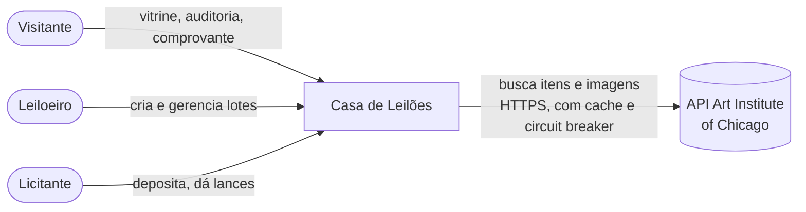
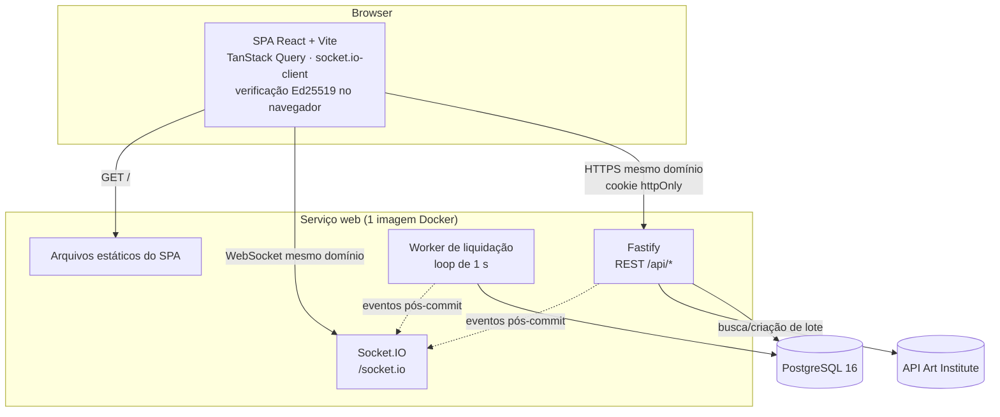
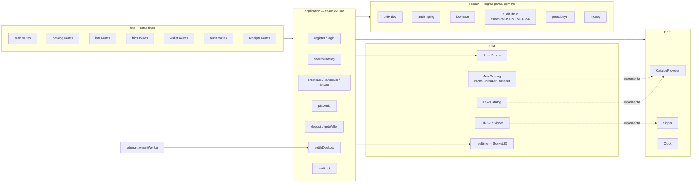
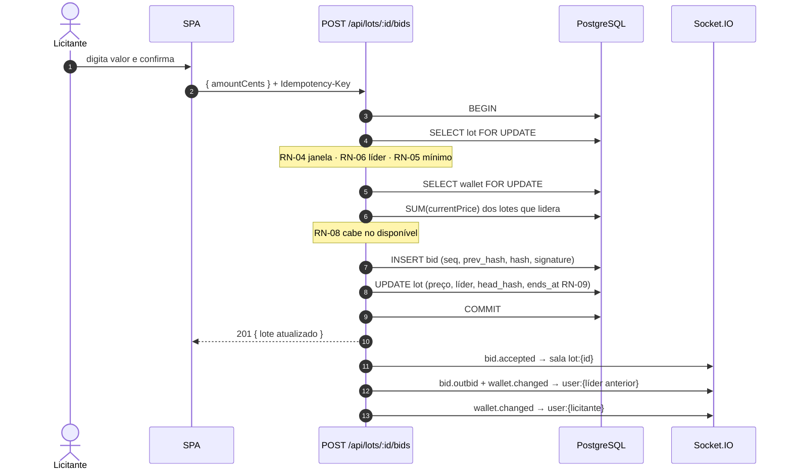
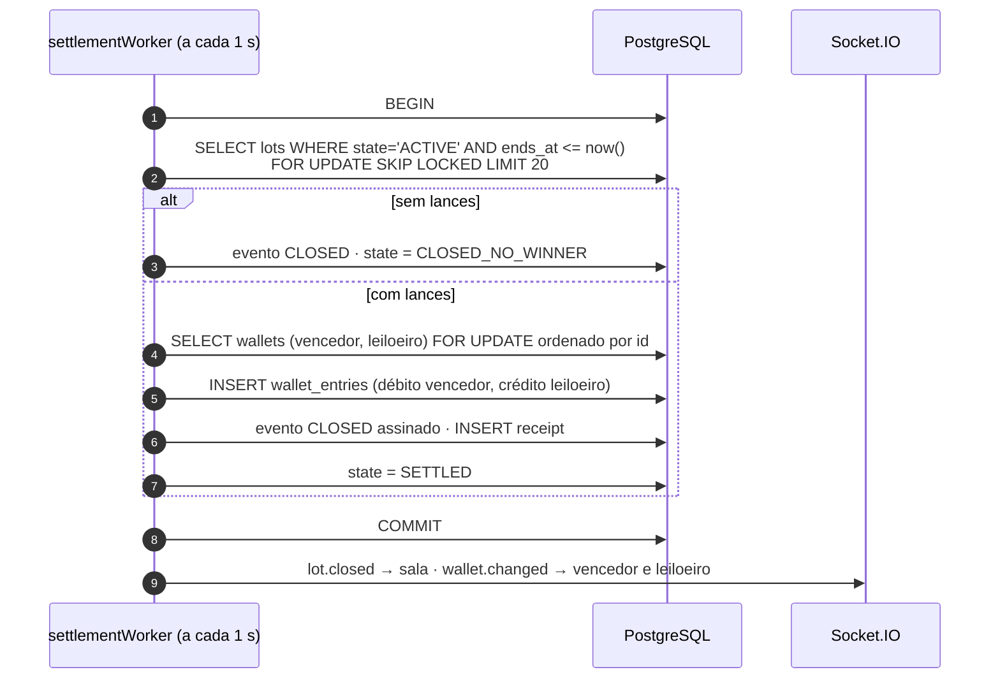
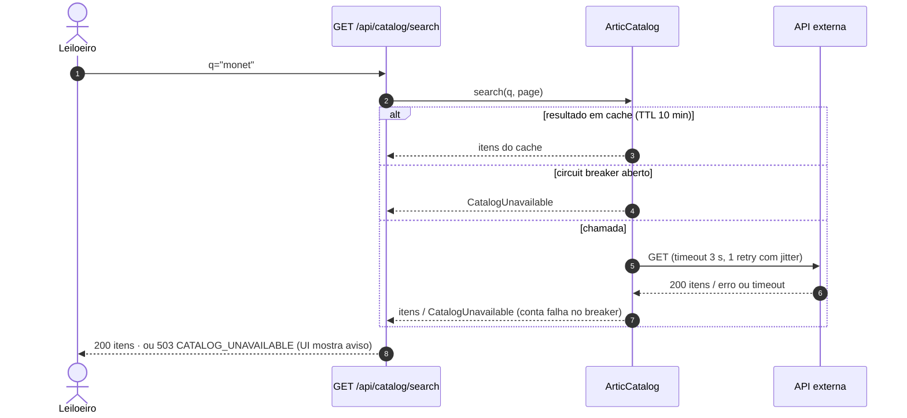
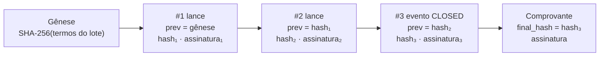

# 03 — Arquitetura

Diagramas em Mermaid (o GitHub renderiza). Regras citadas como `RN-xx` estão em
[`02-regras-de-negocio.md`](02-regras-de-negocio.md).

---

## 1. Contexto



A API externa só é usada na **busca** e na **criação de lote**. Todo o resto lê do nosso banco
(RN-20, RN-21).

---

## 2. Containers (deploy)



**Um único serviço** serve API, WebSocket e o build do SPA: mesmo domínio, sem CORS, cookie
`SameSite=Lax` funciona, WebSocket autentica pelo mesmo cookie. Em desenvolvimento o Vite roda
separado com proxy para a API.

---

## 3. Componentes do back-end



Regras de dependência: `domain` não importa nada de fora; `application` orquestra transações e
usa `ports`; `http` só valida (Zod de `packages/shared`) e chama casos de uso; detalhes de
Fastify, Socket.IO e Drizzle ficam em `http` e `infra`.

Ports existem **só** onde há troca real de implementação (catálogo real × fake; assinatura com
chave de teste; relógio controlável nos testes). Sem repositórios genéricos ou camadas especulativas.

---

## 4. Fluxos principais

### 4.1 Lance



Recusa em qualquer passo → `ROLLBACK` e erro com código (`BELOW_MINIMUM`, `INSUFFICIENT_FUNDS`,
...), que o SPA traduz para a mensagem da RN.

**Concorrência:** ordem fixa de travas **lote → carteira** (e carteiras por id na liquidação),
então não há deadlock. Lances no mesmo lote são serializados pela linha do lote; lances do mesmo
licitante em lotes diferentes, pela linha da carteira.

### 4.2 Encerramento e liquidação



Idempotente pelo `state` + `SKIP LOCKED`: duas instâncias nunca liquidam o mesmo lote; se o
processo cair no meio, a transação é desfeita e o próximo ciclo refaz.

### 4.3 Busca no catálogo com a API instável



---

## 5. Histórico à prova de adulteração

**Técnica: cadeia de hashes assinada (log append-only), verificável por qualquer pessoa.**



1. **Gênese:** `genesis_hash = SHA-256(JSON canônico dos termos)` — id do lote, pseudônimo do
   vendedor, lance inicial, incremento, início, fim original, título, descrição, categoria,
   `item_snapshot` completo, id do item e hash da imagem.
2. **Cada elo:** `hash = SHA-256(JSON canônico {lotId, seq, type, bidderPseudonym, amountCents,
   createdAt, payload, prevHash})` e `signature = Ed25519(chave privada, bytes UTF-8 do hash
   hexadecimal)`. JSON canônico = chaves
   ordenadas, sem espaços, números inteiros, datas ISO-8601 UTC com milissegundos.
3. **Chave privada só em variável de ambiente** do servidor, nunca no banco. A chave pública fica
   em `GET /api/audit/public-key` e embutida no build do front.
4. **Verificações e o que cada uma detecta:**

| Verificação | Detecta |
|---|---|
| `seq` contínuo 1..N | remoção no meio |
| `prev_hash` = hash do elo anterior; primeiro aponta para a gênese | inserção, reordenação, troca de termos do lote |
| hash recalculado = hash gravado | alteração de qualquer campo |
| assinatura válida com a chave pública | quem tem acesso ao banco e recalcula a cadeia inteira (não tem a chave) |
| `bid_count`/`head_hash` do lote e `final_hash` do comprovante = último elo | truncamento do final (para lotes liquidados) |
| regras RN-04/05/06 reexecutadas sobre o histórico | incoerências semânticas |

5. **Verificação dupla:** o servidor devolve o veredito detalhado e o navegador **refaz tudo
   sozinho** com WebCrypto (fallback `@noble/ed25519`) — o visitante não precisa confiar no servidor.
6. **Limitação conhecida (vai no README):** quem controla **ao mesmo tempo** o banco e a chave
   privada poderia reescrever tudo; e truncar o final de um lote **ainda ao vivo** só é
   detectado se o navegador já tinha visto a cabeça anterior (guardada em `localStorage`). A
   evolução natural seria publicar checkpoints dos hashes num serviço externo independente.
7. **Defesa extra (não substitui a detecção):** trigger que bloqueia `UPDATE`/`DELETE` em `bids`
   e `lot_events` para o usuário da aplicação.

---

## 6. Tempo real

| Canal | Quem entra | Eventos |
|---|---|---|
| `lot:{id}` | qualquer pessoa na sala | `bid.accepted`, `lot.extended`, `lot.closed`, `lot.cancelled` |
| `user:{id}` | o próprio usuário (cookie no handshake) | `bid.outbid`, `wallet.changed` |

- Eventos são emitidos **depois do commit** (nunca anunciam algo que foi desfeito).
- Toda resposta REST e evento carrega `serverTime`; o SPA calcula o offset do relógio para a
  contagem regressiva.
- Ao reconectar, o SPA invalida as queries e refaz o snapshot via REST — evento perdido não
  deixa a tela inconsistente.
- Uma instância basta para o teste. Escalar horizontalmente exigiria o adapter Postgres/Redis do
  Socket.IO (não implementado — YAGNI).

---

## 7. Segurança

| Tema | Medida |
|---|---|
| Senhas | argon2id |
| Sessão | JWT assinado (HS256) em cookie `httpOnly`, `Secure`, `SameSite=Lax`, 7 dias |
| CSRF | `SameSite=Lax` + rotas mutáveis exigem `Content-Type: application/json` |
| Autorização | Por papel e por dono do recurso **no servidor**; a UI só esconde botões |
| Entrada | Zod em todas as rotas e eventos; limites de tamanho |
| Abuso | `@fastify/rate-limit` em login, cadastro, busca no catálogo e lances |
| Cabeçalhos | `@fastify/helmet` (CSP compatível com imagens servidas pela própria API) |
| Segredos | `JWT_SECRET`, `AUDIT_SIGNING_PRIVATE_KEY`, `PSEUDONYM_SECRET` só em env; `.env.example` sem valores reais |
| PII | Respostas públicas montadas por DTOs explícitos, com teste de contrato |

---

## 8. Estrutura de pastas

```
apps/
  api/src/
    domain/        bidRules, antiSniping, lotPhase, auditChain, pseudonym, money
    application/   casos de uso (um arquivo por caso)
    ports/         CatalogProvider, Signer, Clock
    infra/         db/ (schema, migrations), catalog/, crypto/, realtime/
    http/          rotas, plugins (auth, erros, rate limit), schemas
    jobs/          settlementWorker
    main.ts        composição (injeta implementações reais ou fakes)
  web/src/
    routes/        páginas por rota
    features/      lots, bidding, wallet, audit, auctioneer, auth
    components/    UI compartilhada (acessível)
    lib/           api client, socket, money, time offset, audit verify
packages/
  shared/src/      schemas Zod, códigos de erro, eventos realtime, tipos
```

---

## 9. Decisões de stack (por quê)

### D1 — Front-End: React + Vite (SPA), e não Next.js

| Critério | Vite (SPA) | Next.js |
|---|---|---|
| Natureza do app | Altamente interativo e em tempo real — o caso típico de SPA | Brilha com SSR/SEO e páginas majoritariamente estáticas |
| Deploy | Gera estáticos que o próprio back-end serve → **1 serviço, 1 domínio** | Runtime Node próprio (ou Vercel) separado do back-end |
| Cookies / WebSocket | Mesmo origin: cookie `SameSite=Lax` e WebSocket sem CORS | Domínios diferentes → CORS, cookie `SameSite=None`, WebSocket cross-origin |
| Complexidade | Uma forma de renderizar | Server/Client Components, cache do App Router, dois ambientes |

O que se perde: SEO e prévia de link. O PDF não pede SEO; se der tempo, a API injeta meta tags
Open Graph só em `/comprovante/:code`. React sem ferramenta de build não compensa: o CRA foi
descontinuado e configurar bundler à mão não agrega à avaliação.

### D2 — Back-End: Node.js + Fastify, e não NestJS ou Express puro

| Critério | Fastify | NestJS | Express |
|---|---|---|---|
| Cerimônia | Baixa: plugins e funções | Alta: módulos, decorators, DI | Mínima |
| Validação/serialização | Schemas por rota nativos (usamos Zod compartilhado) | Pipes | Manual |
| Erros e hooks | `setErrorHandler`, hooks `onRequest`/`preHandler` para auth e papel | Filters e Guards | Middlewares manuais |
| Desempenho | Alto | Bom (sobre Express/Fastify) | Médio |
| Testes | `app.inject()` sem abrir porta | `TestingModule` | supertest |
| Ecossistema necessário | `@fastify/cookie`, `jwt`, `rate-limit`, `helmet`, `static` oficiais | Completo | Pacotes de terceiros |

Fastify dá a estrutura necessária (plugins encapsulados, hooks de auth, schemas) sem a
cerimônia do NestJS, que em 7 dias consumiria tempo das regras de negócio. Em relação ao
Express, já traz validação, tratamento de erros, `inject` para testes e plugins oficiais de
segurança. A organização em camadas (seção 3) fica por conta da estrutura de pastas, não do framework.

### D3 — Banco: PostgreSQL

| Necessidade | Recurso |
|---|---|
| Lances simultâneos no mesmo lote | Transações ACID + `SELECT … FOR UPDATE` |
| Mesmo saldo em dois lotes | `FOR UPDATE` na carteira |
| Liquidar exatamente uma vez | `FOR UPDATE SKIP LOCKED` |
| Invariantes | `CHECK`, `UNIQUE (lot_id, seq)` |
| Histórico append-only | Trigger bloqueando `UPDATE`/`DELETE` |
| Snapshot do item / imagem | `jsonb` / `bytea` |
| Busca (opcional) | `pg_trgm` |
| Dinheiro exato | `BIGINT` em centavos |

MySQL 8 também atenderia o essencial, mas `jsonb`, `pg_trgm`, `CHECK` e triggers são mais
maduros no Postgres e há mais oferta gratuita gerenciada (Neon, Supabase, Render, Railway).
MongoDB não combina: os dados são relacionais e o núcleo é consistência financeira sob
concorrência.

### D4 — Drizzle ORM, e não Prisma

As regras dependem de `FOR UPDATE` / `SKIP LOCKED`; o Drizzle expressa isso tipado
(`.for('update', { skipLocked: true })`), no Prisma seria SQL cru. As migrations do Drizzle são
SQL legível, fácil de revisar e explicar.

### D5 — Socket.IO, e não WebSocket puro ou SSE

Salas por lote/usuário, reconexão automática e fallback prontos. SSE seria suficiente para
servidor → cliente, mas Socket.IO simplifica salas e autenticação no handshake.

### D6 — TypeScript ponta a ponta em monorepo pnpm

Front, back e `packages/shared` (schemas Zod, códigos de erro, tipos de eventos) na mesma
linguagem: o contrato da API é checado pelo compilador nos dois lados, e o avaliador clona um
único repositório.

### D7 — Art Institute of Chicago como API externa

Pública, sem chave, imagens IIIF de domínio público e atributos ricos (artista, data, técnica,
dimensões). Reserva: Metropolitan Museum API (mesmo port `CatalogProvider`).
