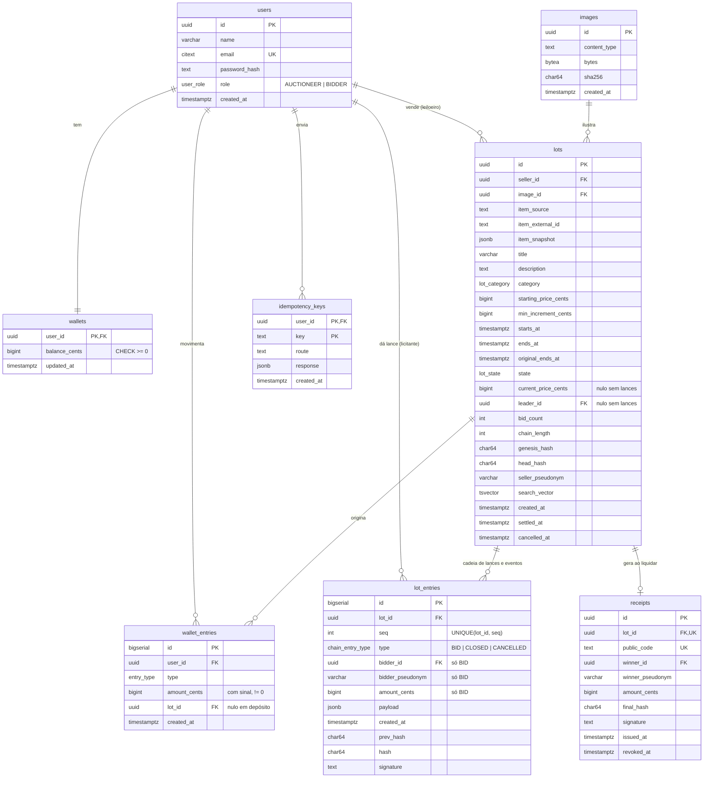

# 04 — Modelagem de dados

PostgreSQL 16, schema e migrations versionados com Drizzle (`apps/api/src/infra/db`). Este
documento é a referência do schema; mudanças nele exigem migration nova (nunca editar migration
já aplicada).

Convenções:
- Dinheiro: `BIGINT` em **centavos** (sufixo `_cents`). Nunca `float`/`numeric` no código.
- Tempo: `TIMESTAMPTZ(3)` em UTC; valores "agora" vêm de `now()` do banco.
- IDs: `UUID` (v7, ordenável) para entidades; `BIGSERIAL` para registros de log.
- Hashes: hexadecimal minúsculo, `CHAR(64)`; assinaturas Ed25519 em base64url.
- Nomes de tabela/coluna em inglês `snake_case`; enums em maiúsculas.

---

## 1. Diagrama ER



---

## 2. Enums

| Enum | Valores |
|---|---|
| `user_role` | `AUCTIONEER`, `BIDDER` |
| `lot_state` | `ACTIVE`, `SETTLED`, `CLOSED_NO_WINNER`, `CANCELLED` |
| `lot_category` | `PAINTING`, `SCULPTURE`, `PHOTOGRAPHY`, `PRINT`, `DRAWING`, `TEXTILE`, `OTHER` |
| `entry_type` (carteira) | `DEPOSIT`, `SETTLEMENT_DEBIT`, `SETTLEMENT_CREDIT`, `REFUND_DEBIT`, `REFUND_CREDIT` |
| `chain_entry_type` | `BID`, `CLOSED`, `CANCELLED` |

A **fase** exibida (agendado, ao vivo, encerrado) não é coluna: é derivada de `state`,
`starts_at`, `ends_at` e `now()` (RN-03), evitando um job só para trocar status.

---

## 3. Tabelas — restrições e observações

### `users`
- `email` `CITEXT UNIQUE` (comparação sem diferenciar maiúsculas).
- `role` imutável (não há rota que altere).

### `wallets`
- Uma linha por usuário, criada no cadastro (inclusive leiloeiro, que recebe créditos).
- `CHECK (balance_cents >= 0)`.
- `balance_cents` é um **cache** da soma de `wallet_entries`, atualizado na mesma transação de
  cada lançamento. É a linha travada com `FOR UPDATE` para serializar operações do usuário.

### `wallet_entries` (livro-razão, append-only)
- `CHECK (amount_cents <> 0)`; sinal: depósito e créditos positivos, débitos negativos.
- `lot_id` obrigatório para `SETTLEMENT_*` e `REFUND_*` (`CHECK`).
- `UNIQUE (lot_id, type)` parcial para `SETTLEMENT_*`/`REFUND_*` → impossível liquidar ou
  estornar o mesmo lote duas vezes, mesmo com bug no worker.

### `images`
- Bytes da imagem baixada na criação do lote (RN-20), tipicamente 843 px de largura (IIIF),
  ~100–300 KB. Servida por `GET /api/images/:id` com `Cache-Control: public, max-age=31536000, immutable`.
- `sha256` entra na gênese da cadeia (trocar a imagem é detectável).

### `lots`
- `CHECK (starting_price_cents > 0 AND min_increment_cents > 0)`
- `CHECK (ends_at > starts_at)` e `CHECK (original_ends_at <= ends_at)` (anti-sniping só aumenta).
- `CHECK ((bid_count = 0) = (leader_id IS NULL))` e o mesmo para `current_price_cents`.
- `item_snapshot` (`jsonb`): artista, data, técnica, dimensões, origem, URL de referência — o que
  a API devolveu no momento da criação. Imutável e incluído na gênese, junto de título, descrição
  e categoria.
- `chain_length` = nº de elos em `lot_entries` (lances + eventos); `bid_count` = só lances.
- `head_hash` = hash do último elo (ou `genesis_hash` se vazio).
- `seller_pseudonym` = pseudônimo do leiloeiro (mesma regra RN-16), usado na gênese.
- `search_vector` (`tsvector` gerado de título, descrição e artista) para RF-17.

### `lot_entries` (cadeia, append-only)
- Um registro por lance (`BID`) ou evento (`CLOSED`, `CANCELLED`) — **uma tabela só** para que
  `seq` seja contínuo e verificável com uma única consulta ordenada.
- `UNIQUE (lot_id, seq)`; `seq` vem de `lots.chain_length + 1` sob a trava do lote.
- `CHECK (type <> 'BID' OR (bidder_id IS NOT NULL AND amount_cents IS NOT NULL))`.
- `payload` (`jsonb`): dados extras do elo, ex. `{ "endsAtAfter": "…" }` quando houve
  prorrogação, `{ "winnerPseudonym": "…", "amountCents": … }` no `CLOSED`.
- `bidder_id` é usado **apenas** internamente (posição do usuário, "meus lances"); nunca
  aparece em respostas públicas e **não entra no hash** (entra o pseudônimo).
- Trigger `BEFORE UPDATE OR DELETE` → `RAISE EXCEPTION` (defesa extra; a detecção real é a
  criptográfica, que funciona mesmo se o trigger for removido).

### `receipts`
- `public_code`: 128 bits aleatórios em base64url (22 caracteres).
- `final_hash` = `head_hash` do lote após o elo `CLOSED`; `signature` = Ed25519 sobre
  `{lotId, finalHash, amountCents, winnerPseudonym, issuedAt}` canônico.
- `revoked_at` preenchido no cancelamento com estorno (RN-13).

### `idempotency_keys`
- PK `(user_id, key)`; guarda a resposta da primeira execução de `POST /bids` e `POST /wallet/deposits`.
- Gravada na mesma transação da operação; limpeza de chaves com mais de 24 h no worker.

---

## 4. Índices

| Índice | Uso |
|---|---|
| `lots (state, ends_at)` | worker de liquidação; vitrine "encerrando em breve" |
| `lots (state, starts_at)` | vitrine de agendados |
| `lots (leader_id) WHERE state = 'ACTIVE'` | cálculo do saldo comprometido (RN-07) |
| `lots (seller_id, created_at DESC)` | painel do leiloeiro |
| `lots USING GIN (search_vector)` | busca textual (RF-17) |
| `lots (category, current_price_cents)` | filtros (RF-17) |
| `lot_entries (lot_id, seq)` (unique) | sala, auditoria |
| `lot_entries (bidder_id, lot_id)` | "Meus arremates" |
| `wallet_entries (user_id, created_at DESC)` | extrato da carteira |

---

## 5. Consultas centrais

**Saldo comprometido (RN-07):**

```sql
SELECT COALESCE(SUM(current_price_cents), 0) AS committed_cents
FROM lots
WHERE state = 'ACTIVE' AND leader_id = $1;
```

**Lotes a liquidar (RN-10):**

```sql
SELECT * FROM lots
WHERE state = 'ACTIVE' AND ends_at <= now()
ORDER BY ends_at
FOR UPDATE SKIP LOCKED
LIMIT 20;
```

---

## 6. Invariantes (verificadas em testes de integração)

| # | Invariante |
|---|---|
| I-1 | `wallets.balance_cents = SUM(wallet_entries.amount_cents)` por usuário |
| I-2 | `balance_cents − comprometido ≥ 0` para todo licitante |
| I-3 | Para lote com lances: `current_price_cents` e `leader_id` = valor e licitante do último `BID` |
| I-4 | `seq` de `lot_entries` é 1..`chain_length` sem buracos |
| I-5 | Lote `SETTLED` tem exatamente 1 `SETTLEMENT_DEBIT`, 1 `SETTLEMENT_CREDIT` e 1 `receipt` |
| I-6 | Lote `CLOSED_NO_WINNER` tem `bid_count = 0` e nenhum lançamento financeiro |
| I-7 | Soma de todos os `wallet_entries` exceto `DEPOSIT` = 0 (dinheiro só muda de mãos) |

---

## 7. Dados de demonstração (seed)

| Entidade | Conteúdo |
|---|---|
| Usuários | `leiloeiro@demo.com` (AUCTIONEER), `ana@demo.com` e `bruno@demo.com` (BIDDER), senha `demo1234` |
| Carteiras | Ana e Bruno com depósito de R$ 50.000 cada |
| Imagens/itens | Fixtures locais (JSON + imagens de domínio público) — o seed **não** chama a API externa |
| Lotes | 1 ao vivo com lances de Ana e Bruno (fim distante); 1 ao vivo terminando em minutos; 1 agendado; 1 liquidado com comprovante; 1 encerrado sem lances |

Os lances do seed passam pelo mesmo caso de uso `placeBid` (com relógio controlado), então a
cadeia e as assinaturas são válidas e a auditoria do seed dá **íntegro**.
