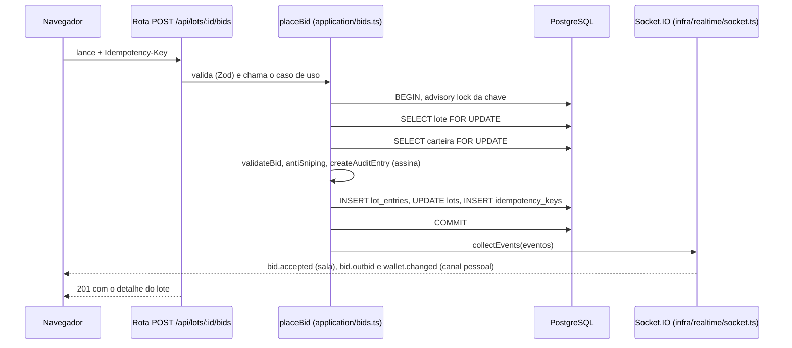

# Estudo de caso: lances concorrentes e histórico auditável

Leitura de 3 a 4 minutos. Cada afirmação aponta para o código e para o teste que a sustenta. Os
resultados de teste citados foram executados em 28/10/2026 sobre `main` `15b2a10` (veja
[Evidência](#evidência)).

> O saldo é simulado. Nenhum dinheiro real é movimentado.

## O problema

Um leilão online parece simples até dois lances chegarem ao mesmo tempo. Sem cuidado, os dois
leem o mesmo "preço atual", os dois passam na validação e o lote fica com dois líderes. Ou o
mesmo saldo cobre lances em dois lotes. Além disso, quem dá lance quer conferir depois que ninguém
mudou o histórico.

Papéis:

- **Leiloeiro:** cria lotes a partir do catálogo.
- **Licitante:** deposita saldo simulado e dá lances.
- **Visitante:** audita o histórico de qualquer lote.

## Fluxo de um lance



| Seta | Onde está |
|---|---|
| Rota fina: Zod e caso de uso | `apps/api/src/http/lots.routes.ts` |
| Transação, travas e escrita | `placeBid` em `apps/api/src/application/bids.ts` |
| Regras puras | `apps/api/src/domain/bidRules.ts`, `antiSniping.ts`, `pseudonym.ts` |
| Elo assinado | `createAuditEntry` em `packages/shared` |
| Publicação após o commit | `collectEvents` em `apps/api/src/app.ts`, que chama `socket.ts` |

## Concorrência: travas na ordem lote → carteira

`placeBid` abre uma transação e trava a linha do lote com `SELECT … FOR UPDATE`. Depois trava a
carteira do licitante. Dois lances no mesmo lote ficam em fila: o segundo só lê o preço depois do
commit do primeiro e, por isso, é validado contra o preço novo.

- O relógio da regra é `clock_timestamp()`, lido **depois** da trava. O `now()` seria o início da
  transação, antes da espera.
- A ordem fixa (sempre o lote, depois a carteira) é a mesma no cancelamento e na liquidação. Isso
  evita deadlock entre esses fluxos.
- O saldo disponível é calculado dentro da transação: soma do extrato menos o preço dos lotes
  ativos em que o licitante lidera. Com a carteira travada, dois lances do mesmo licitante em
  lotes diferentes não usam o mesmo dinheiro.

Testes:

- `serializa 20 lances concorrentes no mesmo lote sem quebrar I3/I4 (CT-05-11)`: 20 lances
  iguais em paralelo resultam em 1 aceito e 19 recusados com `BELOW_MINIMUM`, e a cadeia fica
  com um único elo.
- `serializa o saldo de um licitante em dois lotes (CT-05-12; I-2)`.
- `julga o encerramento pelo relógio depois da trava do lote, não pelo início da transação`.
- `não duplica quando dois workers concorrem (CT-07-03)`: a liquidação usa
  `FOR UPDATE SKIP LOCKED`.

## Idempotência

Toda requisição de lance leva um `Idempotency-Key`. Uma trava consultiva
(`pg_advisory_xact_lock`) sobre usuário e chave serializa repetições, mesmo quando a chave ainda
não existe. A resposta do primeiro lance é gravada em `idempotency_keys`, e a repetição devolve
essa mesma resposta.

- **Falha evitada:** um clique duplo ou um reenvio da rede não cria um segundo lance nem um
  segundo elo na cadeia.
- A chave é conferida de novo depois da trava da carteira, porque um depósito com a mesma chave
  pode ter entrado enquanto o lance esperava.
- **Teste:** `preserva a primeira resposta e não cria novo elo para repetição idempotente (CT-05-14)`.

## Anti-sniping e cliente atualizado

Um lance válido feito a 2 minutos ou menos do fim leva o término para 2 minutos depois do lance
(`domain/antiSniping.ts`, RN-09). Isso gera o evento `lot.extended` junto com `bid.accepted`. O
cliente atualiza o cronômetro pelo evento, sem recarregar a página.

- **Teste:** `estende no limite anti-sniping e coleta eventos somente após commit sem PII (CT-05-06,13,15,16)`.
- **Liquidação:** `não liquida antes do fim prorrogado (CT-07-04)`.

## Eventos só depois do commit

`placeBid` monta a lista de eventos dentro da transação, mas só a entrega a `collectEvents`
depois que a transação termina. Se a transação falha, nada é publicado. Se a publicação falha
depois do commit, o lance continua válido e a resposta continua 201.

Ordem observada nos testes:

1. O `COMMIT` acontece.
2. Os eventos são entregues: `bid.accepted` na sala do lote, mais `bid.outbid` e
   `wallet.changed` no canal pessoal do líder anterior.

Testes:

- `não emite nada quando a transação falha (CT-06-05)`;
- `não emite evento para lance recusado (CT-06-02)`;
- `mantém o 201 quando a entrega pós-commit de eventos falha`;
- `notifica o líder superado apenas no canal pessoal (CT-06-03)`.

Se a conexão cai por pouco tempo, o Socket.IO reenvia os eventos perdidos
(`connectionStateRecovery`, até 2 minutos). Teste:
`reentrega bid.outbid perdido numa queda curta da conexão`.

## Cadeia de auditoria

- **Gênese:** cada lote começa com o hash SHA-256 dos termos do lote, em JSON canônico
  (`domain/auditChain.ts`).
- **Elo:** cada lance vira um elo com `seq`, `prev_hash`, valor, pseudônimo e data. O servidor
  calcula o hash do elo e o assina com Ed25519. A chave privada fica só em variável de ambiente.
- **Proteção no banco:** gatilhos bloqueiam `UPDATE`, `DELETE` e `TRUNCATE` em `lot_entries`.
- **Verificação:** o navegador baixa o relatório e a chave pública e roda `verifyChain`
  (`packages/shared/src/auditVerify.ts`) com WebCrypto. São checados sequência, elos, hashes,
  assinaturas, cabeça, comprovante e regras.
- **Privacidade:** o relatório traz pseudônimos por lote, derivados com HMAC. Não traz nome,
  e-mail nem ID de usuário.

Testes que alteram dados direto no banco e esperam a detecção:

- `detecta alteração direta de valor e restaura o gatilho append-only (CT-08-02)`;
- `detecta uma cadeia recalculada sem a chave privada (CT-08-03)`;
- `detecta remoção de elo intermediário pela sequência (CT-08-04)`;
- `detecta elo forjado com hash válido e assinatura antiga (CT-08-05)`;
- `detecta cauda liquidada removida mesmo com cabeça ajustada (CT-08-06)`;
- `mantém o veredito paritário entre Node e WebCrypto para relatório real (CT-08-10)`;
- `não expõe PII quando o relatório contém elos e recibo (CT-08-11)`.

### O que a auditoria não garante

- A chave pública vem da própria API. A verificação mostra que a cadeia é consistente com essa
  chave. Ela não identifica de forma independente quem controla o servidor.
- Quem controla o banco **e** a chave privada ao mesmo tempo pode reescrever a cadeia inteira.
- Em um lote **ativo**, remover os últimos elos e ajustar a cabeça deixa um prefixo válido. Só
  lotes liquidados têm o comprovante para cruzar o hash final. A evolução natural seria publicar
  checkpoints dos hashes em um serviço externo.

## Decisões descartadas

| Decisão | Por quê |
|---|---|
| Saldo fictício, sem gateway de pagamento | O desafio pede simulação. Um gateway traria custo e risco sem relação com o problema estudado. |
| Uma instância do Socket.IO | Basta para a demo. Escalar horizontalmente exigiria o adapter Postgres ou Redis. Veja `docs/03-arquitetura.md`. |
| Catálogo falso (`FakeCatalog`) em CI e testes | Testes não podem depender da disponibilidade da API externa. O catálogo real só aparece no uso manual. |
| Travas pessimistas (`FOR UPDATE`) em vez de versionamento otimista | Efeito observado no teste CT-05-11: o lance perdedor recebe um erro de regra claro (`BELOW_MINIMUM`), e o cliente não precisa tentar de novo. A comparação com a alternativa otimista não foi medida. |

## Desempenho

Os números abaixo vêm de medições locais já registradas. Servem para comparar antes e depois,
não como SLA.

- **API:** [`docs/perf/api-explain.md`](perf/api-explain.md). `EXPLAIN (ANALYZE, BUFFERS)` no
  PostgreSQL 16 local, com 5.005 lotes e 50.998 elos sintéticos. A página de lotes encerrados
  caiu de 4,39 ms (Seq Scan) para 0,99 ms (Index Scan) com um índice novo.
- **Front:** [`docs/perf/front-bundle.md`](perf/front-bundle.md). Com rotas lazy, o JS carregado
  na vitrine ficou cerca de 10% menor (~333,5 kB, gzip ~103,5 kB). A criptografia da auditoria só
  é baixada quando a auditoria é aberta.

Não há medição de throughput nem de carga em produção. O deploy roda no plano gratuito do
Northflank (0,1 vCPU e 256 MB).

## Evidência

Executado em 28/10/2026 sobre `main` `15b2a10`, com Node 22, PostgreSQL 16 descartável e
`FakeCatalog`.

```text
$ npx vitest run test/integration/bids.test.ts test/integration/audit.test.ts \
    test/integration/realtime.test.ts test/integration/settlement.test.ts   # em apps/api
PASS (46) FAIL (0)

$ pnpm --filter @leilao/shared exec vitest run src/auditVerify.test.ts
Test Files  1 passed (1)
     Tests  22 passed (22)
```

O comportamento em produção está separado em
[`portfolio/lc025-smoke-producao.md`](portfolio/lc025-smoke-producao.md). A suíte completa
(`pnpm test`, `pnpm test:e2e`) roda no CI de cada PR.
